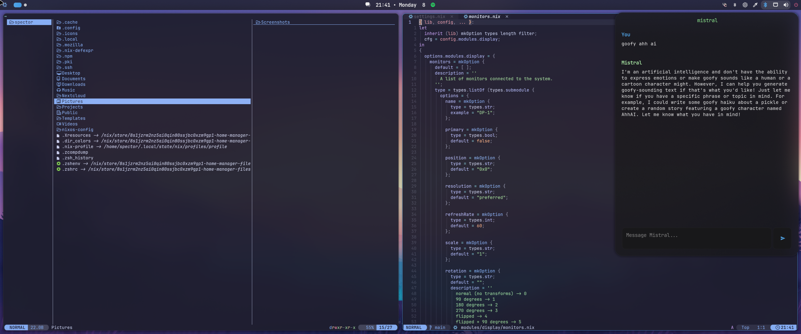
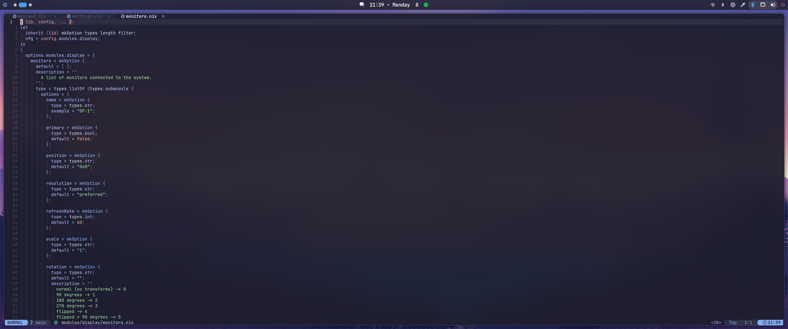

<p align="center"></p>

<p align="center">
<a href="https://nixos.org/"></a>

<p align="center"></p>

---

- **Compositors** • Hyprland (alfheim), Niri (vivo)
- **Shell** • zsh with starship
- **Terminal** • Kitty
- **Panel** • Dank Material Shell
- **File Manager** • Yazi
- **Neovim** • [Akari](https://github.com/spector700/Akari)

---





<p align="center">Screenshots circa 2024-04-09</p>

---

## Configuration

This flake uses flake-parts, flake-aspects and import-tree to organize NixOS and
Home Manager configuration by feature. `features/` contains reusable aspects;
`hosts/` selects them and supplies host-specific settings. The hosts are alfheim
(Hyprland desktop), vivo (Niri laptop), and vanaheim (server). See
[hosts/README.md](hosts/README.md) for adding or installing a host.

Each host selects aspects in `hosts/<host>/<host>.nix` and is registered in
`hosts/_hosts.nix`. import-tree discovers `.nix` files under `features/` and
`hosts/`, except paths with components beginning with `_`; those support files
must be imported explicitly.

The private `nix-secrets` input requires access to its Git repository and the
appropriate SOPS keys.

## Installation

**Disko formatting.** Before installing, review the selected host's disk device,
`features/disko/lvm-btrfs.nix`, hardware configuration, secrets and networking.
Do not run a Disko formatting command on a machine whose data you need to keep.

## Updating and validating

Update flake inputs and validate:

```bash
just update
```

```bash
just check
```

```bash
rebuild
```

Compare the local machine's active generation with a freshly built
configuration:

```bash
just diff <host>
```

Deploy a host remotely over the configured SSH port:

```bash
just rebuild-deploy <host>
```

Test a configuration without making it the default boot entry:

```bash
sudo nixos-rebuild test --flake .#<host>
```

If a switch needs to be reverted, select an earlier generation from the boot
menu or run `sudo nixos-rebuild switch --rollback`.

# 💾 Inspiration

- [fufexan/dotfiles](https://github.com/fufexan/dotfiles)
- [linuxmobile/kaku](https://github.com/linuxmobile/kaku)
- [Gerg-L/nixos](https://github.com/Gerg-L/nixos)
- [Misterio77/nix-config](https://github.com/Misterio77/nix-config)
- [hmajid2301/nixicle](https://github.com/hmajid2301/nixicle/tree/main)
